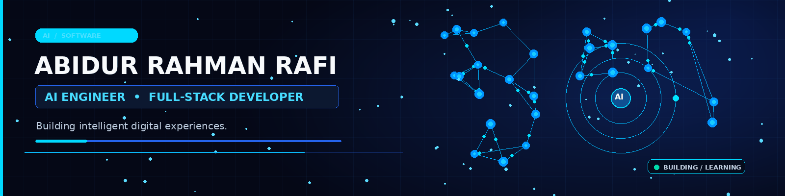

  

  

<h1 align="center">Hi, I'm Abidur Rahman Rafi 👋</h1>
<h3 align="center">AI Engineer in Progress · Full-Stack Developer · React Developer</h3>

  <a href="https://github.com/Rafi741088">GitHub</a> ·
  <a href="https://www.linkedin.com/in/md-abidur-rahman-rafi-969566343/">LinkedIn</a> ·
  <a href="https://github.com/Rafi741088?tab=repositories">Repositories</a>

  Building useful digital experiences with modern web technologies and exploring practical AI integrations.

---

## About Me

- I build modern, responsive web experiences and full-stack application projects.
- I work with **React** and the **JavaScript ecosystem**, and build backend services with **Node.js** and **Express.js**.
- I'm exploring practical AI-powered applications, LLM integrations, and intelligent automation.
- I value clean code, maintainability, accessibility, usability, and continuous learning.
- Based in **Bangladesh** 🇧🇩

## Technology Stack

**Frontend**

  

**Backend and tools**

  

**Exploring**

  
  AI APIs · LLM application development · Machine learning fundamentals

## Featured Projects

### Chacha Vatija Agro
A farm and product-ordering website concept focused on discovering farm products such as fish, poultry, ducks, and goats.

- **Focus:** responsive shopping experience and farm product discovery
- **Stack:** React, Vite, Tailwind CSS *(as described in the existing profile README)*
- **Repository:** [Rafi741088/chacha-vatija-agro](https://github.com/Rafi741088/chacha-vatija-agro)

### Personal Portfolio
A personal portfolio project for presenting skills, selected work, and professional contact information.

- **Repository:** [Rafi741088/my-portfolio](https://github.com/Rafi741088/my-portfolio)
- **Note:** a live deployment URL is omitted until it can be independently confirmed.

### More Repositories
Explore my other projects and experiments in the [repositories tab](https://github.com/Rafi741088?tab=repositories).

## GitHub Overview

  
  

  

> Statistics cards are generated by third-party services. They may be cached, rate-limited, unavailable, or changed by their providers; they are not guaranteed to be real-time.

## Contribution Activity

The contribution graph below is generated by GitHub Actions using actual GitHub contribution data. It appears after the workflow runs successfully.

  

## Current Focus

- Building useful full-stack web applications.
- Improving React patterns, backend APIs, and application architecture.
- Integrating AI APIs into practical software.
- Exploring LLM-powered applications and automation.
- Creating portfolio projects that solve real problems.

## Let's Connect

  
  

Keep learning. Keep building. Keep improving.

